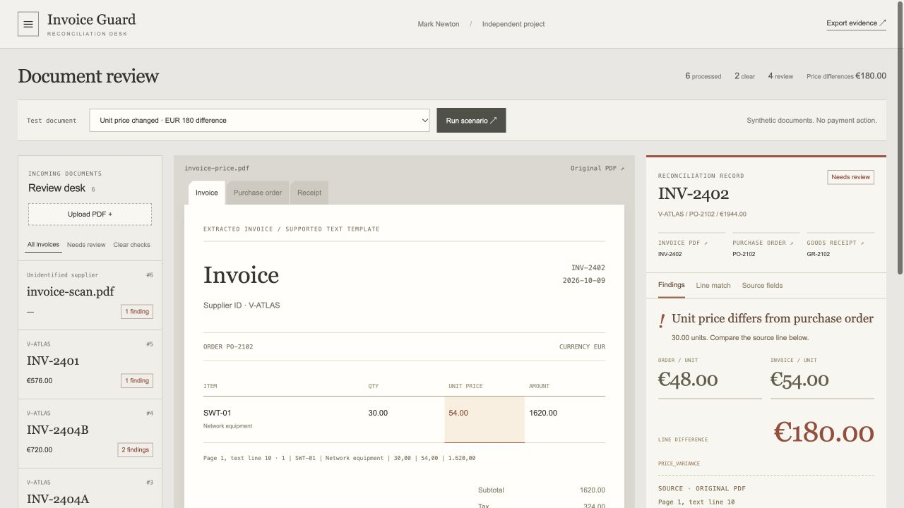
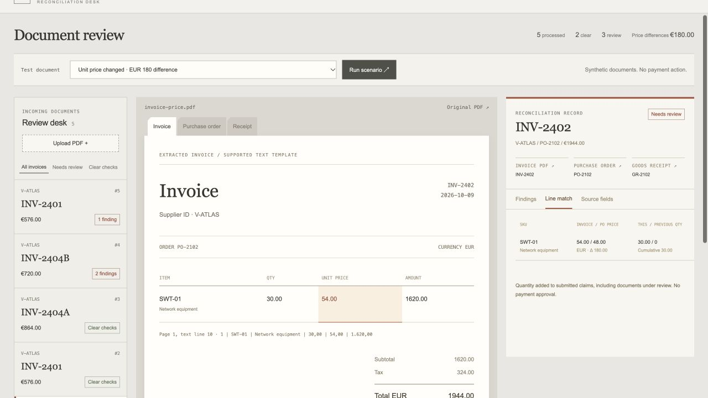
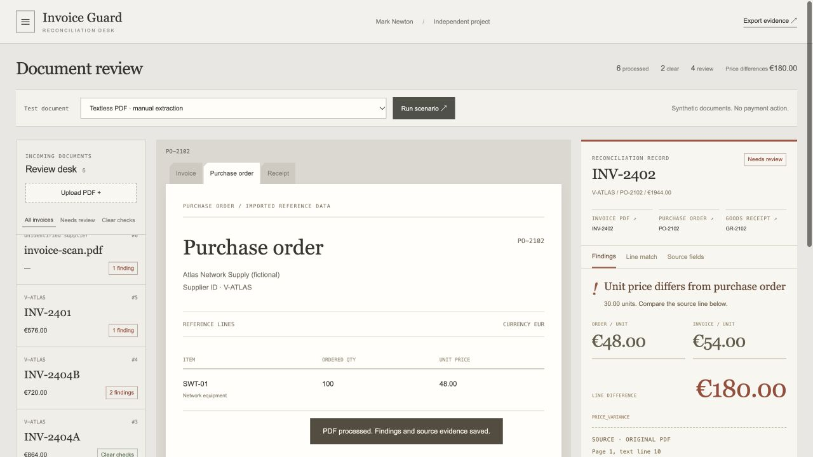

# Invoice Guard

**Find the mismatch. Keep the evidence.**

A working review desk that extracts supported invoice PDFs and checks them against purchase orders, goods receipts and prior submitted quantities.



[One-page brief](invoice-guard-case.pdf) · [Complete source bundle](invoice-guard-source.zip) · [Recorded verification](invoice-guard-verification.json) · [Latest test run](invoice-guard-test-results.txt)

## The problem

An invoice can be arithmetically correct and still disagree with the order or received goods. A later invoice can also exceed the remaining quantity even when its individual lines look reasonable.

Invoice Guard compares each supported document with the reference records, checks cumulative quantities and keeps the source location behind each finding.

## What the desk checks

| Check | Demonstrated behavior |
|---|---|
| Price mismatch | EUR 48 ordered versus EUR 54 invoiced, 30 units: EUR 180 difference |
| Quantity mismatch | 12 invoiced versus eight received: four units exceed receipts |
| Cumulative quantity | Six units followed by five against a ten-unit order: the second invoice is held |
| Duplicate or conflicting content | No repeated quantity reservation for duplicate records |
| Currency and arithmetic | Mismatches are flagged; no inferred currency conversion |
| Missing or unsupported fields | Extraction review instead of fabricated values |

The EUR 180 figure is a difference in a synthetic document, not a customer's recovered money.

## Inspect the evidence

**Line comparison:** invoice, order and receipt quantities remain side by side.



**Reference document:** the reviewer can inspect the imported purchase order behind the finding.



## Verification

**19 automated tests passed.** A separate, fixed synthetic evaluation covered 12 alternate-layout PDFs:

- 168 of 168 labelled fields recovered.
- Nine expected rule findings detected; zero extra or missed rule codes.
- All three clean documents remained clear.

These results describe this small synthetic set. They do not establish accuracy on arbitrary supplier documents.

## Run it

Download and extract [invoice-guard-source.zip](invoice-guard-source.zip). From the extracted `invoice-guard` folder:

```sh
python3 -m pip install -r requirements.txt
python3 app.py
```

Open `http://127.0.0.1:8771`. Python 3.11+; pypdf for text extraction. No external document API.

```sh
python3 -m unittest -v test_guard
```

The bundle includes the full implementation, interface, original PDF fixtures, expected labels, reference records and technical README.

## Scope

Independent project by Mark Newton. Supported text-based PDF templates; other layouts need adapters and scans need OCR. Findings remain review items: the demo does not approve invoices or initiate payments. A production workflow needs authentication, isolated document processing, vendor adapters and a reviewer correction process.

Python · SQLite · pypdf · Decimal arithmetic · JavaScript.

[Back to portfolio](README.md)
