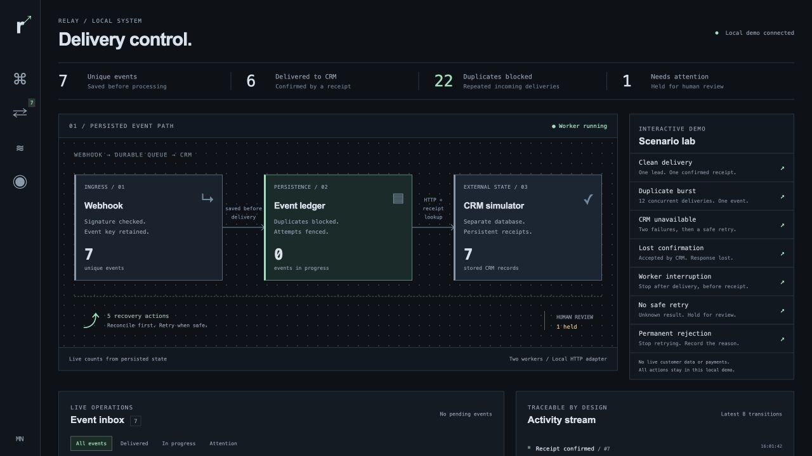
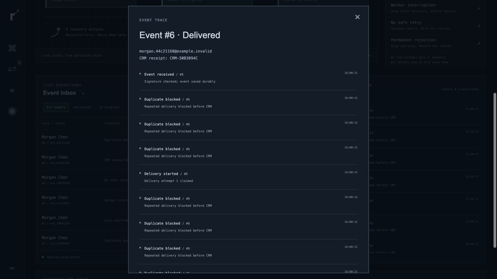
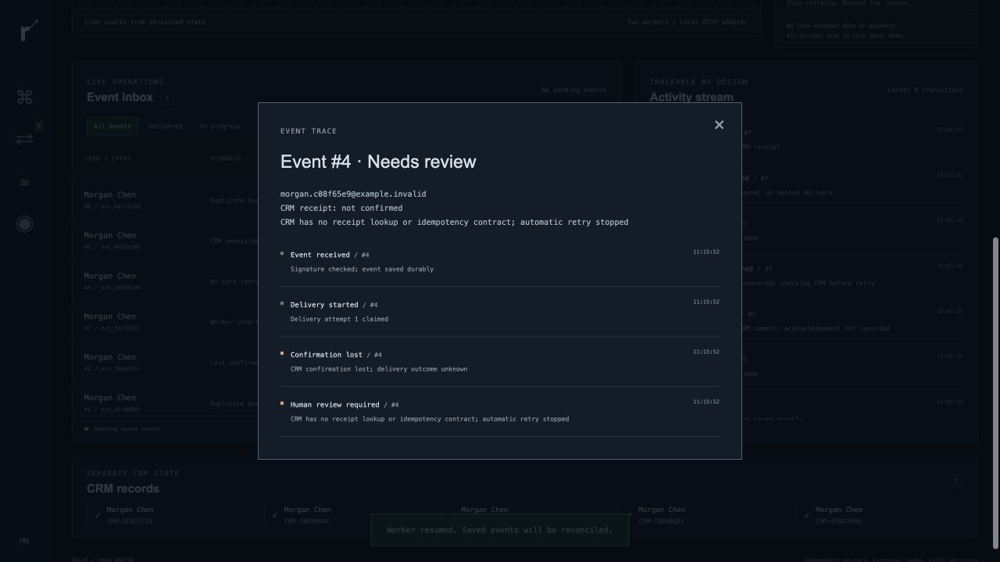

# Relay

**Every event. Accounted for.**

A working webhook-to-CRM system with a durable inbox, duplicate handling, bounded retries and an event audit trail.



[One-page brief](relay-case.pdf) · [Complete source bundle](relay-source.zip) · [Recorded verification](relay-verification.json) · [Latest test run](relay-test-results.txt)

## The problem

A CRM may accept a lead and lose the HTTP response. Retrying blindly can create another contact. Treating a timeout as a rejection can lose a successful delivery.

Relay records incoming events before processing, assigns durable operation keys and reconciles uncertain outcomes against the simulated CRM's receipts. When an API cannot support safe verification, the event goes to review.

## Verified behavior

| Scenario | Observed result in the local test |
|---|---|
| 100 concurrent copies of one event | One unique inbox event, 99 repeats blocked, one CRM POST, one contact |
| CRM unavailable | Two injected HTTP 503 responses; success on the third claimed attempt |
| Response lost after CRM commit | Receipt lookup confirmed delivery without a second POST |
| Worker process killed after CRM commit | Restart recovered delivery; one CRM contact |
| Opaque result without safe retry support | Held for review |
| Permanent rejection | Stopped after one attempt |

**14 automated tests passed.** These are functional checks, not throughput or production reliability benchmarks.

## Inspect the result

**Duplicate events:** persisted event identity and processing history remain visible.



**Uncertain delivery:** an explicit review state prevents an unsafe automatic resend.



## Run it

Download and extract [relay-source.zip](relay-source.zip). From the extracted `relay` folder:

```sh
python3 app.py --port 8767
```

Open `http://127.0.0.1:8767`. Python 3.11+; no external accounts or paid services.

```sh
python3 -m unittest -v test_relay
```

The source bundle contains the full implementation, interface, tests and technical README. It also includes an optional, unexecuted n8n import template.

## Implementation

Python · SQLite · JavaScript · HMAC-SHA256 · local HTTP adapter.

Signed webhook → atomic inbox insert → fenced worker lease → CRM operation → receipt reconciliation → audit record.

## Scope

Independent engineering demo by Mark Newton. Fictional leads and a local CRM simulator; no live client system is connected. Safe recovery depends on the receiving API's idempotency or lookup contract. Production work needs a client CRM adapter, authentication, deployment, monitoring and workload-specific checks.

[Back to portfolio](README.md)
