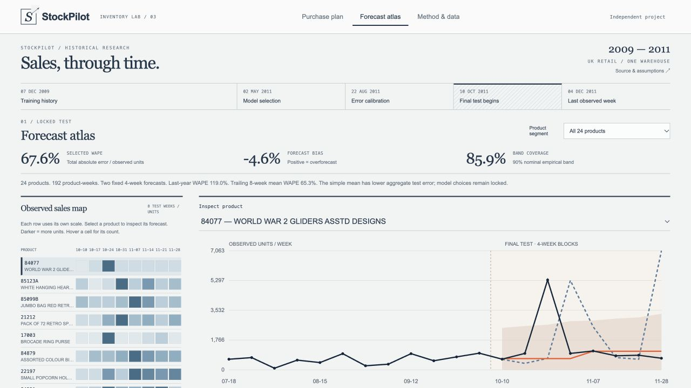
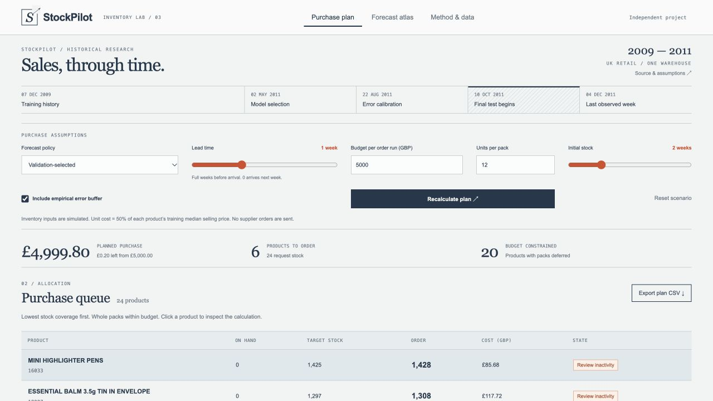
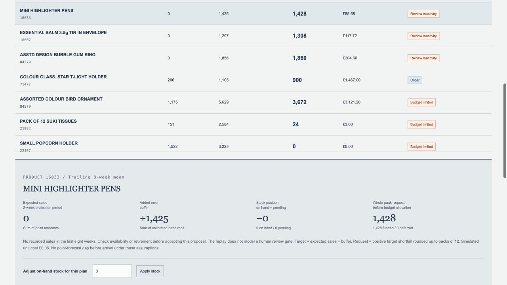

# StockPilot

**Test the forecast. Explain the order.**

A working sales-forecast evaluation and replenishment tool. Historical sales stay visible beside forecasts; purchasing assumptions can be changed and inspected.



[One-page brief](stockpilot-case.pdf) · [Complete source bundle](stockpilot-source.zip) · [Recorded verification](stockpilot-verification.json) · [Latest test run](stockpilot-test-results.txt)

## The problem

A forecast needs a credible comparison against simple methods. A purchasing recommendation also needs to explain how lead time, budget, stock and pack size changed the proposed order.

StockPilot separates those questions. Forecasts are scored on later historical periods; inventory policies are replayed under explicit simulation assumptions. Model selection stays locked after the final results are inspected.

## Inspect the decisions

**Purchase plan:** proposed quantities respond to the available budget, lead time, pack size and starting stock.



**Explain an order:** inspect the product's protection period, inventory position and rounded purchase quantity.



## Measured forecast results

Final evaluation: **24 products, 192 product-weeks**. Model choices used earlier validation periods.

| Forecast method | Final WAPE; lower is better |
|---|---:|
| Per-product validation-selected method | 67.6% |
| Trailing eight-week mean | 65.3% |
| Same week last year | 119.0% |

The simple mean has lower aggregate error than per-product selection. The interface exposes that result rather than presenting a universal winner. Zero-sales cases, product-level comparisons and empirical error bands remain available for inspection.

**23 automated tests passed**, including chronology, budget limits, pack rounding, lead-time alignment and inventory conservation.

## Run it

Download and extract [stockpilot-source.zip](stockpilot-source.zip). From the extracted `stockpilot` folder:

```sh
python3 app.py
```

Open `http://127.0.0.1:8773`. Python 3.10+; the app and tests use the standard library. The attributed data extract and measured results are included.

```sh
python3 -m unittest -v test_stockpilot
```

The bundle includes the full implementation, interface, data extract, locked model choices, evaluation protocol and technical README. Rebuilding from the original workbook is documented separately in that README.

## Data and scope

Chen, D. (2012). **Online Retail II**. UCI Machine Learning Repository. [Dataset](https://archive.ics.uci.edu/dataset/502/online+retail+ii) · [DOI](https://doi.org/10.24432/C5CG6D) · [CC BY 4.0](https://creativecommons.org/licenses/by/4.0/).

The delivered extract derives UK weekly positive product sales and a training-selected cohort; it excludes customer identifiers. Cleaning decisions and source hashes are recorded in the bundle.

Independent project by Mark Newton. Inventory costs, initial stock, availability and purchasing outcomes are simulated assumptions, not measured client savings. Production work needs current client data, lifecycle and availability records, real costs and lead times, authentication and operational controls. No supplier order is placed.

Python · JavaScript · SVG charts · deterministic forecast baselines.

[Back to portfolio](README.md)
